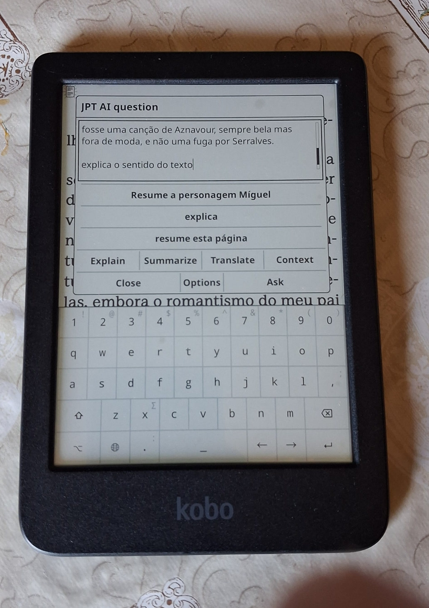

# JPT AI for KOReader

Your reading companion for KOReader: select any word or passage and ask AI for its meaning, an explanation, a summary, a translation, or a discussion in the context of the book.

Functional specification and rules (Portuguese): [ESPECIFICACAO.md](ESPECIFICACAO.md).

<p align="center">
  
  
</p>

## Features

- Ask free-form questions about the current page, chapter, book, or selected text.
- Get the contextual meaning of a selected word or expression with one tap.
- Explain, summarize, and translate selected passages with one tap.
- Pick the primary and secondary reading contexts directly in the question dialog.
- Remember separate secondary-context choices for questions with and without selected text.
- Remember the last primary context, page counts, secondary **Only previous pages** choice, response length, translation language, and answer font size. Use **Ask (last settings)** or the `Open JPT AI` gesture to reopen those choices.
- Adjust response font size, translation language, and response length from the plugin options. Choose **Short**, **Medium**, **Long**, or **Very long**. A changed length is saved for the next **Translate**, **Summarize**, **Explain**, or **Meaning** action you choose. Each action then reuses its own saved length until you change it again. Existing installations start each action with the previously saved length.
- Send requests to an AI chat-completions endpoint that you configure yourself.
- Keep the reader responsive while a request runs, show elapsed time, and display streamed answer text when the endpoint supports it. Retry without streaming when the endpoint rejects streaming requests.
- Warn before sending context above the configured approximate token threshold.

## Requirements

- A device running KOReader.
- Network access from KOReader.
- An API key and a compatible AI chat-completions endpoint.

## Installation

1. Copy this directory to KOReader's `plugins` directory as `jpt_ai.koplugin`.
2. Create the private configuration file:

   ```sh
   cp jpt_ai_config.example.lua jpt_ai_config.lua
   ```

3. Edit `jpt_ai_config.lua` with your endpoint, API key, model, and preferred request settings.
4. Restart KOReader.

`jpt_ai_config.lua` is deliberately excluded from Git, so your endpoint and API key remain local to your device.

## Configuration

`jpt_ai_config.lua` has this shape:

```lua
return {
    base_url = "https://your-api-host.example/v1/chat/completions",
    api_key = "your-api-key",
    model = "your-model-name",
    temperature = 0.2,
    max_output_tokens = 12000,
    request_timeout = 180,
    context_warning_tokens = 24000,
    reasoning_effort = "low",
}
```

Use the URL required by your AI provider. Never commit `jpt_ai_config.lua` or share its API key.

## Using the plugin

- Open **JPT AI** from KOReader's tools menu. Choose **Ask (last settings)** to reuse the saved choices, or one of the minimum, medium, and maximum presets for a one-off scope. The `Open JPT AI` gesture also uses the saved choices.
- The menu presets choose the Main context scope: **minimum** uses the current page, **medium** uses three centered pages, and **maximum** uses the whole book. With selected text, the selection remains the Main context. In the current implementation, the saved Secondary-context choice takes precedence over the preset's secondary scope, separately for questions with and without selected text; see the specification for details.
- Select text in a book to open **JPT AI** directly; KOReader's selection menu and dictionary popup are skipped for that selection.
- The selected text goes directly to JPT AI as its Main context and is prefilled in the question field, ready for you to continue typing. It is sent as context only once and is not repeated in the result header.
- Use **Translate**, **Summarize**, **Explain**, or **Meaning** for a quick response, or write a custom question.
- Without selected text, use **MAIN CONTEXT** to choose primary pages, the current chapter, or the complete book. Primary **Pages (n)** uses the original odd totals from 1 to 21, centered on the current page. Secondary **Pages (n)** offers 1, 2, 4, 8, 16, 32, 64, 128, and so on, both with and without selected text. Its **Only previous pages** checkbox includes the current page and up to n-1 preceding pages. When unchecked, secondary pages surround the current page, with one extra preceding page for even totals. Ranges stop at book boundaries. **Apply** saves the secondary count and checkbox; counts are remembered separately for questions with and without selected text, while the checkbox is shared. Existing secondary radii migrate to total counts; the previous primary checkbox choice moves to secondary context. Primary counts are restored to odd totals within 1 to 21.
- With selected text, the selection is shown as the fixed **MAIN CONTEXT**.
- The **SECONDARY CONTEXT** row contains **None**, **Pages (n)**, **Chapter**, and **Book**, with or without selected text. Choose **Pages (1)** for only the current page. Existing **Page** choices migrate to **Pages (1)**.
- The secondary page-range heading marks the current page: `214 - 245 (current page)` for preceding pages, or `243 - 245 (current page) - 247` when the range extends in both directions.
- Tapping **Pages (n)** selects it immediately. Closing the number selector without applying changes keeps **Pages (n)** selected and retains the saved count and checkbox.

### Quick-action labels

The detailed instructions sent to the configured model remain hidden. The answer dialog identifies only the chosen action and its target:

| Button | Selected text | Pages | Chapter | Book |
| --- | --- | --- | --- | --- |
| **Translate** | `Translate: <selected text>` | `Translate: current page (<page number>)` | `Translate: current chapter (<chapter>)` | `Translate: current book - <book name>` |
| **Summarize** | `Summarize: <selected text>` | `Summarize: current page (<page number>)` | `Summarize: current chapter (<chapter>)` | `Summarize: current book - <book name>` |
| **Explain** | `Explain: <selected text>` | `Explain: current page (<page number>)` | `Explain: current chapter (<chapter>)` | `Explain: current book - <book name>` |
| **Meaning** | `Meaning: <selected text>` | `Meaning: current page (<page number>)` | `Meaning: current chapter (<chapter>)` | `Meaning: current book - <book name>` |

For **Translate**, the model uses the language selected under **Options → Translation language**. Each quick action remembers its own **Response length**, which controls the expected detail and maximum output-token allowance. A newly chosen length applies to the next action submitted.

### How Main and Secondary context are used

- **Main context** is the content the model must act on. When text is selected, the selection becomes the Main context. Otherwise, the chosen primary pages, chapter, or complete book become the Main context.
- With selected text, **MAIN CONTEXT** shows **Selected text** as a fixed status instead of showing irrelevant page, chapter, and book controls.
- **Secondary context** is optional supporting book text. It helps the model interpret the Main context, but it is not itself the content to explain, summarize, or translate.
- The plugin remembers separate Secondary-context choices and page counts for questions with and without selected text. **Pages (1)** includes only the current page in either case.
- **Meaning** relies on the Secondary context to identify how a selected word or expression is used in the surrounding text. With Secondary context disabled, the model may have only the selected word or expression and therefore less evidence for a context-specific meaning.
- Every request tells the model to base its answer strictly on the supplied book context, act on the Main context, and use the Secondary context only as supporting material.
- Requests run in a background worker using KOReader's HTTPS path. The answer dialog updates the elapsed time every five seconds and shows streamed text in batches when the endpoint supports it. **Cancel request** stops the worker. If streaming is rejected, the plugin retries once without streaming; the total wait remains limited by `request_timeout`.
- Each streamed display update keeps the answer on page 1, without following the last page as content grows. The completed answer also opens at the beginning.
- Context larger than `context_warning_tokens` triggers a confirmation before sending. The estimate is approximate, and lowering the threshold makes the warning appear sooner. The default is 24,000 estimated tokens.

| Secondary context | Exact content sent |
| --- | --- |
| **None** | No secondary text |
| **Pages (n)** | Up to n pages including the current page: preceding pages only when **Only previous pages** is checked, otherwise surrounding pages; limited by the book boundaries |
| **Chapter** | The complete current chapter |
| **Book** | The complete current book |

No additional book text is added automatically beyond the selected Secondary-context scope. A Secondary context may overlap the Main context when the user explicitly chooses an overlapping scope.

The answer dialog shows the quick-action label directly, such as `Meaning: current book - Book name`, without a preceding `Question:` heading.

## Privacy

The selected text and requested context are sent only to the endpoint configured in your private `jpt_ai_config.lua`. The plugin does not include an endpoint or API key in this repository.

## Compatibility

This plugin was tested on a **Kobo Clara BW (P365)** running KOReader. It is intended to work on any device that runs KOReader, although other devices and KOReader versions have not yet been tested.

## Developer checks

From the plugin repository root, run `luajit tests/test_context_policy.lua` for context extraction and request-error classification. Run `luajit tests/test_response_lengths.lua` for action-specific response lengths, migration, and preference reload using KOReader UI/settings stubs.

## Repository contents

- `main.lua` — plugin implementation.
- `_meta.lua` — KOReader plugin metadata.
- `jpt_ai_config.example.lua` — safe private-configuration template.
